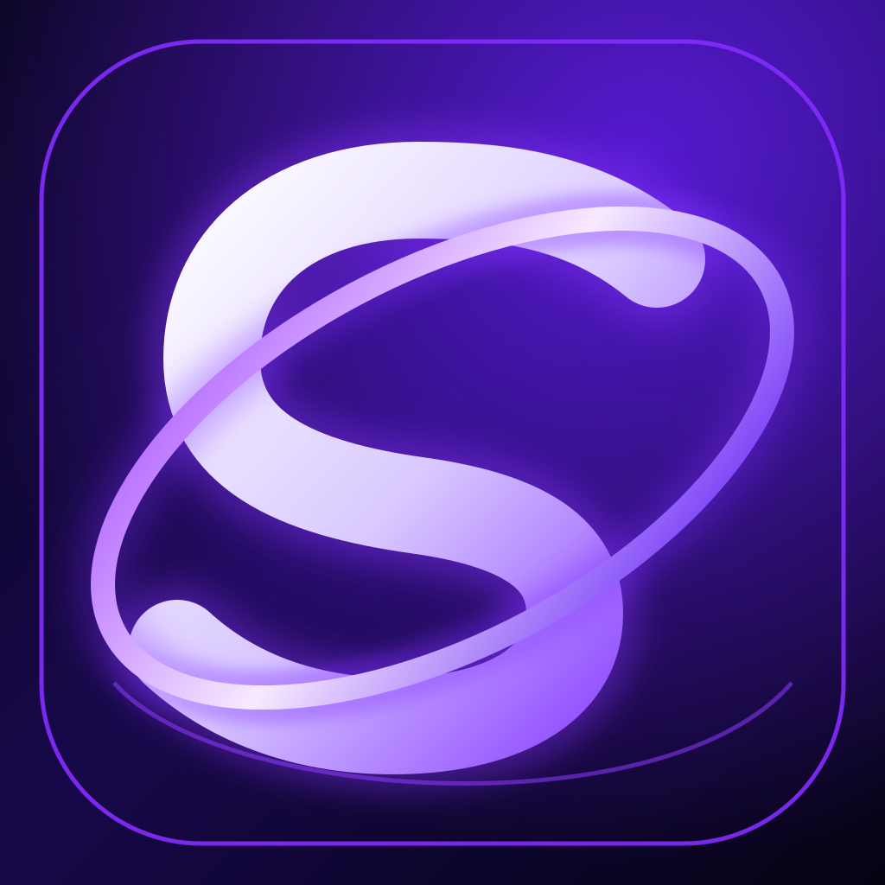

<p align="center">
  
</p>

<h1 align="center">Stride</h1>

<p align="center">Run Android apps and games on iPhone through a native compatibility runtime.</p>

<p align="center"><strong>Experimental Android translation layer for iOS</strong></p>

Stride is an independent project built by modifying and extending the open-source Husk codebase. The app, product identity, interface and ongoing development are branded as **Stride**. Original upstream copyright notices and third-party licence terms remain preserved in the source tree.

## What Stride is

Stride is an experimental iOS runtime that aims to load Android application packages and translate the Android software interfaces they depend on into native iOS-compatible services.

Current development areas include:

- **DEX runtime:** opcode coverage, exceptions, class loading, method dispatch and multi-DEX execution.
- **Android framework:** Activities, resources, PackageManager, intents and Android services.
- **JNI and native compatibility:** Bionic APIs, ABI handling, ELF loading and native symbol resolution.
- **Graphics:** OpenGL ES and Vulkan translation to Apple's graphics stack.
- **Input and audio:** touch, controller, sound and device-sensor integration.
- **Game testing:** real-device compatibility checks for Subway Surfers, Hill Climb Racing, Beach Buggy 2 and Dr. Driving.

Compatibility is not guaranteed by APK scanning or successful installation. A game is considered working only after it launches and renders correctly on a real device.

## Build

Build on macOS with Xcode and the required native build tools:

```sh
./scripts/ci_build.sh
```

The standard output is `build/Stride.ipa`.

For an unsigned CI build, open **Actions → Stride Unsigned iOS IPA** and run the workflow on `main`. The packaging scripts generate the Stride icon before Xcode compiles the asset catalog. A successful run uploads the `Stride-unsigned-IPA` artifact.

## Compatibility and limitations

Stride is experimental. Some Android APIs, native libraries, graphics paths and games are not implemented yet. Check the project documentation and test reports for verified status; do not treat planned features as completed.

The existing `com.husk.app` bundle identifier and `husk://` URL scheme are intentionally retained during this transition so an update can preserve installation and sideload callback compatibility. They are internal compatibility identifiers, not the displayed product name.

## Licence and upstream attribution

Stride contains modified code derived from **Husk** by Leviidev and contributors. The applicable project licence is **GPL-2.0-or-later**; see [LICENSE](LICENSE) and [docs/01-licensing.md](docs/01-licensing.md). Original copyright notices and all bundled third-party notices must remain with the source and distributed builds. This project is not the original upstream Husk release.
